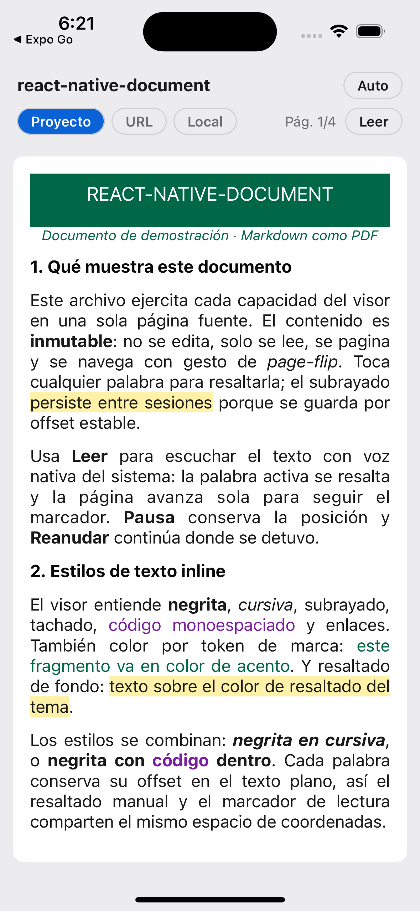
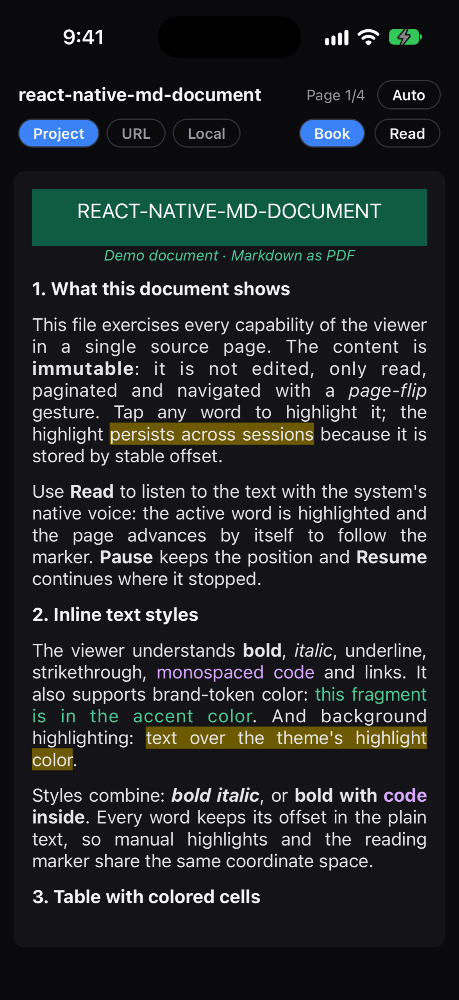

# react-native-document

Visor de documentos **Markdown-como-PDF** para React Native: documento inmutable, con paso
de hoja animado, zoom, subrayado persistente, text-to-speech con resaltado sincronizado y
tema claro/oscuro. Sin librerías de terceros para el contenido (parser y render propios); el
storage, el origen del documento y el motor de voz son inyectables.

## Vista previa

Documento de demostración (`example/`) en tema claro y oscuro: banner con tokens de marca,
estilos en línea, resaltado y adaptación de color por tema.

| Claro | Oscuro |
|---|---|
|  |  |

## Características

- **Render Markdown** + **HTML embebido**: encabezados, párrafos, listas, blockquote, code,
  `hr`, estilos en línea (negrita, cursiva, código, tachado, enlaces), **tablas** y HTML con
  estilos inline (color, fondo, centrado, tamaños, anchos de columna).
- **Paso de hoja** animado (Reanimated + Gesture Handler), un gesto = una página.
- **Zoom** por pinch + arrastre, compuesto con el flip y el tap.
- **Subrayado** por palabra, **persistente entre sesiones** (storage inyectable).
- **Text-to-speech** con resaltado de la palabra hablada (incluso en tablas), pausa/reanudar,
  velocidad, y auto-avance de página siguiendo la lectura.
- **Tema claro/oscuro** (`auto` sigue el SO) con tokens de color adaptables por tema.
- **Orígenes**: URL remota, ruta local del dispositivo, ruta del proyecto.
- **Orientación** vertical y horizontal (re-pagina al rotar).

## Requisitos

| Plataforma | Mínimo | Nota |
|---|---|---|
| **iOS** | 13.0 | Deployment target del módulo nativo (`react-native-document.podspec`). TTS con resaltado por palabra incluido. |
| **Android** | 7.0 (API 24) | `minSdkVersion` del módulo. El TTS habla en API 24+, pero el **resaltado por palabra** durante la lectura usa `onRangeStart`, que requiere **Android 8.0 (API 26)**. |
| **React Native** | 0.76 | Probado con RN 0.76.5 / Expo SDK 52. |
| **Peer deps** | `react-native-reanimated` ≥ 3.16 · `react-native-gesture-handler` ≥ 2.20 | Únicas dependencias visuales. |

## Instalación

```sh
# npm
npm install react-native-document react-native-gesture-handler react-native-reanimated

# yarn
yarn add react-native-document react-native-gesture-handler react-native-reanimated
```

`react-native-reanimated` requiere su plugin de Babel (último en la lista):

```js
// babel.config.js
module.exports = {
    presets: ['babel-preset-expo'],
    plugins: ['react-native-reanimated/plugin'],
};
```

La app debe envolver la raíz en `GestureHandlerRootView`:

```tsx
import { GestureHandlerRootView } from 'react-native-gesture-handler';

export default function App() {
    return <GestureHandlerRootView style={{ flex: 1 }}>{/* … */}</GestureHandlerRootView>;
}
```

Para el **text-to-speech nativo**, el módulo `DocumentSpeech` se autoenlaza como cualquier
paquete RN:

```sh
npx pod-install          # iOS (o: cd ios && pod install)
# Android: autolinking por gradle, sin pasos extra
```

### Dependencias opcionales

- **Almacenamiento del subrayado**: la librería **no** depende de
  `@react-native-async-storage/async-storage`. El store es inyectable
  (`getItem`/`setItem`, sync o async): sirve AsyncStorage, MMKV, SQLite o el
  tuyo. Instálalo **solo si** quieres persistir subrayados con esa opción; para
  subrayado en memoria usa `createMemoryHighlightStore()`, y sin subrayado no
  necesitas nada. Ver [Subrayado persistente](#subrayado-persistente).

Únicas dependencias obligatorias: `react-native-reanimated` y
`react-native-gesture-handler` (los peers).

## Inicio rápido

```tsx
import { DocumentViewer, parse } from 'react-native-document';

const doc = parse('# Hola\n\nUn documento **Markdown**.');

export function Viewer() {
    return <DocumentViewer document={doc} />;
}
```

`DocumentViewer` mide el contenido, lo pagina al tamaño del viewport y habilita flip + zoom.
`parse(source)` devuelve un `MDDocument` inmutable con `plainText` (la proyección de texto que
usan highlight y TTS).

## Orígenes del documento

`useDocumentSource` cubre los tres orígenes:

```tsx
import { DocumentViewer, useDocumentSource } from 'react-native-document';

function Screen() {
    // Proyecto (bundled): string o { markdown }
    const { document, isLoading, error, reload } = useDocumentSource({ markdown: MD_STRING });
    // URL remota: fetch integrado
    // useDocumentSource({ uri: 'https://example.com/doc.md' })
    // Ruta local del dispositivo
    // useDocumentSource({ uri: 'file:///…/doc.md' })

    if (!document) {
        return null; // isLoading / error / reload disponibles
    }
    return <DocumentViewer document={document} />;
}
```

Detección de string: con `http(s)://`, `file:`, `content:`, `asset:` o que empiece con `/` se
trata como URI; cualquier otro string es Markdown crudo.

Para orígenes que `fetch` no cubre (asset del bundle, `file://` en Android) se inyecta un
lector — la librería **no fuerza** `expo-file-system` ni `expo-asset`:

```tsx
import * as FileSystem from 'expo-file-system';

useDocumentSource(
    { uri: 'file:///…/doc.md' },
    { readUri: (uri) => FileSystem.readAsStringAsync(uri) },
);
```

## Subrayado persistente

```tsx
import { DocumentViewer, createKeyValueHighlightStore, useHighlights } from 'react-native-document';
import AsyncStorage from '@react-native-async-storage/async-storage';

const store = createKeyValueHighlightStore(AsyncStorage); // sirve para AsyncStorage/MMKV

function Screen({ document }) {
    const { highlights, toggleWordAt, remove, clear, isLoaded } = useHighlights({
        docId: 'doc-1',
        plainText: document.plainText,
        store, // sin store: solo en memoria
    });
    return (
        <DocumentViewer
            document={document}
            highlights={highlights}
            onWordPress={toggleWordAt} // toca una palabra para subrayar / quitar
        />
    );
}
```

Cada subrayado es `{ id, start, end, color? }` en el espacio de offsets de la proyección. Como
el documento es **inmutable**, ese espacio es estable entre sesiones, tamaños de pantalla y
re-render. `createMemoryHighlightStore()` sirve para tests/demo.

## Text-to-speech

```tsx
import {
    DocumentViewer,
    createNativeSpeechEngine,
    createMockSpeechEngine,
    useTextToSpeech,
} from 'react-native-document';

// Motor nativo propio (iOS AVSpeechSynthesizer / Android TextToSpeech).
// Cae al mock (por timer, sin audio) si el módulo nativo no está enlazado.
function makeEngine() {
    try {
        return createNativeSpeechEngine();
    } catch {
        return createMockSpeechEngine({ wordsPerMinute: 200 });
    }
}
const engine = makeEngine();

function Screen({ document }) {
    const [pageStart, setPageStart] = React.useState(0);
    const tts = useTextToSpeech({
        plainText: document.plainText,
        engine,
        options: { rate: 1 }, // multiplicador de velocidad
    });

    const onPress = () => {
        if (tts.status === 'speaking') tts.pause();
        else if (tts.status === 'paused') tts.resume();
        else tts.play(pageStart); // arranca en el inicio de la página actual
    };

    return (
        <>
            <DocumentViewer
                document={document}
                active={tts.activeRange} // resalta la palabra hablada y auto-avanza de página
                onPageChange={(index, count, startOffset) => setPageStart(startOffset)}
            />
            <Button
                title={tts.status === 'speaking' ? 'Pausa' : tts.status === 'paused' ? 'Reanudar' : 'Leer'}
                onPress={onPress}
            />
        </>
    );
}
```

- `useTextToSpeech` devuelve `{ status, activeRange, index, count, play, pause, resume, stop }`.
  `status` es `'idle' | 'speaking' | 'paused'`.
- `play(fromOffset?)` arranca en la utterance que cubre ese offset (usa `pageStartOffset` de
  `onPageChange` para leer desde la página actual). `pause`/`resume` conservan la posición
  (nativo: mitad de utterance). `stop` reinicia.
- `activeRange` es la palabra hablada en offsets de proyección; el visor la resalta con
  `colors.activeWord` y **auto-avanza de página** para seguir la lectura.
- `options.rate` es un multiplicador (1 = normal). Android lo aplica directo; iOS usa una
  curva sobre la velocidad por defecto de `AVSpeechUtterance`.
- El motor es inyectable (`SpeechEngine`): nativo propio, mock, o el tuyo
  (`speak`, `stop`, opcional `pause`/`resume`).

## Tema y tokens de color

```tsx
<DocumentViewer
    document={doc}
    colorScheme="auto" // 'auto' (default, sigue el SO) | 'light' | 'dark'
    theme={{ colors: { link: '#c026d3' } }} // override parcial sobre la paleta del modo activo
/>
```

`useDocTheme(colorScheme, override, colorTokens?)`, `useColorMode(colorScheme)`, `lightTheme`,
`darkTheme` y `mergeTheme` están exportados para teñir tu propio chrome con la misma resolución.

### Documentos con color que se adaptan al tema

Un `.md` con HTML embebido que hardcodea colores (`background:#FFFFFF`, `color:#006847`) **no
cambia** en modo oscuro. El sub-estándar: el archivo usa **tokens** `var(--token)` en vez de
literales, y el visor los resuelve contra la paleta activa. Mezclar literales y tokens es
válido (retrocompatible).

```html
<div style="background: var(--accent); color: var(--on-accent);">…barra…</div>
<p style="color: var(--accent-text); font-style: italic;">…nota…</p>
<p style="color: var(--text);">…cuerpo…</p>
```

Dos clases de token:

- **Base — los define la librería** (su propia paleta light/dark, sin adivinar):
  `--page-bg`, `--text`, `--heading`, `--rule`, `--link`, `--code`, `--highlight`.
- **Marca/custom — los provee el consumidor** por prop `colorTokens`, con valores por modo:

```tsx
<DocumentViewer
    document={doc}
    colorScheme="auto"
    colorTokens={{
        light: { accent: '#006847', 'on-accent': '#ffffff', 'accent-text': '#006847' },
        dark: { accent: '#0f5c43', 'on-accent': '#ffffff', 'accent-text': '#4ecb96' },
    }}
/>
```

Un token que no es base **ni** está en `colorTokens` del modo activo se **omite** (la librería
no inventa colores). El fondo de página y el texto salen siempre de la paleta base, así que un
documento sin tokens de marca ya respeta claro/oscuro.

## Gestos

- **Swipe horizontal** → pasa de página (flip). Un gesto = una página.
- **Pinch** → zoom; con zoom, **arrastrar** mueve la página (el flip se bloquea). Prop
  `maxScale` (default 3).
- **Tap** en una palabra → `onWordPress(offset)`.

El pan solo captura arrastre real (umbral), dejando pasar el tap.

## Orientación

El visor es *size-driven*: al rotar, mide el nuevo tamaño y **re-pagina** solo. Habilitá
landscape en la config nativa de tu app (Expo: `app.json` `orientation: "default"`; RN puro:
`UISupportedInterfaceOrientations` en iOS y `android:screenOrientation` en Android). En
horizontal, usá `SafeAreaProvider` de `react-native-safe-area-context` con
`initialMetrics={initialWindowMetrics}` para insets correctos desde el primer frame.

## Markdown y HTML soportado

**Markdown**: encabezados ATX (`#`…`######`), párrafos, listas ordenadas/no-ordenadas
(anidadas), blockquote, code fence, regla horizontal, tablas GFM, y estilos en línea
`**negrita**`, `*cursiva*`, `` `código` ``, `~~tachado~~`, `[enlace](url)`.

**HTML embebido**: si el documento empieza con HTML de bloque, se parsea como subconjunto HTML
(`div`, `p`, `h1..6`, `table`/`tr`/`td`/`col`, `strong`, `em`, `span`, …) honrando el atributo
`style`: `text-align`, `color`, `background`, `font-size`, `font-weight`, `font-style`,
`text-transform`, `border-top`, `margin-top`, anchos de `<col>`. Útil para conversiones
docx→HTML de alta fidelidad. Los colores adaptables usan tokens (ver arriba).

**Límites (v1)**: sin imágenes ni enlaces de navegación; un bloque más alto que la página
scrollea dentro de su hoja; el HTML es un subconjunto (sin `colspan`, imágenes ni CSS externo).

## API

| Export | Tipo | Descripción |
|---|---|---|
| `parse(source)` | fn | Markdown/HTML → `MDDocument` (con `plainText`) |
| `DocumentViewer` | componente | Visor completo: paginación + flip + zoom |
| `MarkdownView` | componente | Render simple con scroll (sin paginar) |
| `PaginatedDocument` | componente | Paginación controlada (`pageIndex`) sin flip |
| `useDocumentSource(source, opts?)` | hook | Carga URL / local / proyecto (`readUri` inyectable) |
| `useHighlights(params)` | hook | `{ highlights, toggleWordAt, add, remove, clear, isLoaded }` |
| `createKeyValueHighlightStore(kv)` · `createMemoryHighlightStore()` | fn | Stores de subrayado |
| `useTextToSpeech(params)` | hook | `{ status, activeRange, play, pause, resume, stop, index, count }` |
| `createNativeSpeechEngine()` · `createMockSpeechEngine(opts?)` | fn | Motores de voz |
| `useDocTheme` · `useColorMode` · `lightTheme` · `darkTheme` · `mergeTheme` · `resolveThemeColor` | tema | Resolución, paletas y tokens |

### Props de `DocumentViewer`

| Prop | Tipo | Default | Descripción |
|---|---|---|---|
| `document` | `MDDocument` | — (requerido) | Documento parseado con `parse(...)` |
| `colorScheme?` | `'auto' \| 'light' \| 'dark'` | `'auto'` | Tema; `auto` sigue el SO |
| `theme?` | `Partial<DocTheme>` | paleta del modo | Override parcial de colores/tamaños |
| `colorTokens?` | `{ light?: Record<string,string>; dark?: Record<string,string> }` | — | Tokens de marca por modo, para `var(--token)` |
| `highlights?` | `Highlight[]` | `[]` | Subrayados a pintar (`{ id, start, end, color? }`) |
| `active?` | `ActiveRange \| null` | `null` | Palabra hablada por el TTS; se resalta y auto-avanza de página |
| `onWordPress?` | `(offset: number) => void` | — | Tap en una palabra (para subrayar/quitar) |
| `onPageChange?` | `(pageIndex: number, pageCount: number, pageStartOffset: number) => void` | — | Notifica cambio de página |
| `maxScale?` | `number` | `3` | Zoom máximo por pinch |

`MarkdownView` y `PaginatedDocument` comparten `theme` / `colorScheme` / `colorTokens` /
`highlights` / `active` / `onWordPress`; `PaginatedDocument` añade `pageIndex` y
`onPagesChange?(count)`.

## Arquitectura

La pieza clave es la **proyección** `MDDocument.plainText`: la concatenación de todo el texto
visible en orden de lectura. Cada token de texto lleva `[start, end)` en ese espacio, con la
invariante `token.text === plainText.slice(start, end)`. Sobre ella se apoyan el subrayado
persistente y el resaltado de TTS.

Módulos internos: `parser`, `render`, `pagination`, `flip`, `highlights`, `source`, `speech`.

## Desarrollo

```sh
# npm
npm test          # parser, paginación, highlights, source, speech, tema
npm run typecheck
npm run lint
npm run format

# yarn
yarn test
yarn typecheck
yarn lint
yarn format
```

El ejemplo ejecutable está en `example/` (Expo): ejercita orígenes, tema claro/oscuro con
tokens, subrayado persistente y TTS.

```sh
cd example
yarn install          # o: npm install
npx pod-install ios   # primera vez / tras cambiar deps nativas
yarn ios              # o: yarn android  (o: npm run ios / npm run android)
```

## Licencia

MIT
